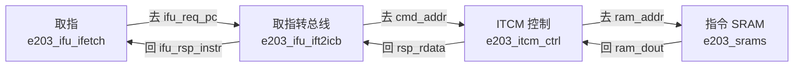

# E203：从 PC 到 ITCM 的一次取指

> **平台**：蜂鸟 E203 v2。默认配置在 `rtl/e203/core/config.v`：PC 与指令 32 位，ITCM 基地址 `0x8000_0000`，容量 64KB  
> **本文**：程序放在 ITCM 时，一条取指从 `pc_r` 送到 SRAM，再把指令送回 `ifu_rsp_instr`

---

## 目录

- [1. 四块电路](#1-四块电路)
- [2. 取指请求：103 根](#2-取指请求103-根)
- [3. ICB 到 ITCM：85 根](#3-icb-到-itcm85-根)
- [4. SRAM 片选：151 根](#4-sram-片选151-根)
- [附录 A 源码索引](#附录-a-源码索引)

---

## 1. 四块电路

取一条落在 ITCM 里的指令，数据经过这四块电路。`rtl/e203/core/e203_ifu.v`、`e203_core.v`、`e203_cpu.v` 把两边同名的线接上，线里的数不变。



前两跳用 `valid` / `ready`。同一拍两个信号都为 1，这一拍的地址或数据才传过去。第三跳用片选 `itcm_ram_cs` 和写使能 `itcm_ram_we`。

核内这几跳按位宽并行传送：32 位 PC 是 32 根线，64 位读数据是 64 根线。UART、SPI、I2C 的串行时序在芯片引脚上。

## 2. 取指请求：103 根

`e203_ifu_ifetch` 把 PC 发给 `e203_ifu_ift2icb`，对方稍后把 32 位指令送回来。`valid` 为 1 时，同一通道上的地址或指令有效。

| 方向 | 信号 | 根数 | 含义 |
| --- | --- | --- | --- |
| 取指 → 转总线 | `ifu_req_valid` | 1 | 这一拍有新的取指请求 |
| 取指 → 转总线 | `ifu_req_pc` | 32 | 要取的 PC，等于 `pc_nxt` |
| 取指 → 转总线 | `ifu_req_seq` | 1 | 这次是不是顺序取指 |
| 取指 → 转总线 | `ifu_req_seq_rv32` | 1 | 上一条是不是 32 位指令 |
| 取指 → 转总线 | `ifu_req_last_pc` | 32 | 上一拍的 PC，就是 `pc_r` |
| 转总线 → 取指 | `ifu_req_ready` | 1 | 转总线可以接收这次请求 |
| 转总线 → 取指 | `ifu_rsp_valid` | 1 | 指令已经准备好 |
| 转总线 → 取指 | `ifu_rsp_err` | 1 | 这次访问出错 |
| 转总线 → 取指 | `ifu_rsp_instr` | 32 | 组好的 32 位指令 |
| 取指 → 转总线 | `ifu_rsp_ready` | 1 | 取指模块可以接收这条指令 |

根数：

- 请求通道 67 根，再加 1 根 `ifu_req_ready`
- 响应通道 34 根，再加 1 根 `ifu_rsp_ready`
- 一共 103 根

`rtl/e203/core/e203_ifu_ifetch.v` 里，`ifu_req_pc` 接在组合结果 `pc_nxt` 上：

```verilog
assign ifu_req_pc = pc_nxt;
```

顺序取指时，32 位指令 `pc_nxt = pc_r + 4`，16 位压缩指令 `pc_nxt = pc_r + 2`。取指 PC 存在寄存器 `pc_r`。`ift2icb` 内部还有 `ifu_req_hsked = ifu_req_valid & ifu_req_ready`。它为 1 时这次请求握手完成，状态机离开空闲。

## 3. ICB 到 ITCM：85 根

`e203_ifu_ift2icb` 和 `e203_itcm_ctrl` 之间走 ICB。命令通道送地址，响应通道送回数据。取指是读。`rtl/e203/core/e203_cpu.v` 把读信号接成 1，写数据和写掩码接成 0。这三项是常数，`ift2icb` 没有把它们拉成导线。

| 方向 | 信号 | 根数 | 含义 |
| --- | --- | --- | --- |
| 转总线 → ITCM | `ifu2itcm_icb_cmd_valid` | 1 | 有一次读请求 |
| 转总线 → ITCM | `ifu2itcm_icb_cmd_addr` | 16 | ITCM 字节地址，取自 PC 的低 16 位 |
| ITCM → 转总线 | `ifu2itcm_icb_cmd_ready` | 1 | ITCM 控制器可以接收这条命令 |
| ITCM → 转总线 | `ifu2itcm_icb_rsp_valid` | 1 | 读数据已经返回 |
| ITCM → 转总线 | `ifu2itcm_icb_rsp_err` | 1 | 访问出错 |
| ITCM → 转总线 | `ifu2itcm_icb_rsp_rdata` | 64 | 一次读出的 64 位 |
| 转总线 → ITCM | `ifu2itcm_icb_rsp_ready` | 1 | 转总线可以接收返回数据 |

根数：

- 命令 17 根，再加 1 根 `cmd_ready`
- 响应 66 根，再加 1 根 `rsp_ready`
- 一共 85 根

这 64 位里最多有两条 32 位指令。`e203_ifu_ift2icb.v` 按地址第 2、1 位取出 32 位，作为上一节的 `ifu_rsp_instr`：

| `addr[2:1]` | 从 64 位数据里取 |
| --- | --- |
| `00` | `[31:0]` |
| `01` | `[47:16]` |
| `10` | `[63:32]` |

另有 1 根 `ifu2itcm_holdup`，从 ITCM 控制器送回取指模块，表示 ITCM 正被占用。

PC 高位与 `0x8000_0000` 对不上时，`ift2icb` 走 `ifu2biu_icb_cmd_addr`，进入 `e203_biu`。

## 4. SRAM 片选：151 根

`e203_itcm_ctrl` 与 `e203_srams` 之间，`itcm_ram_cs` 为 1 且 `itcm_ram_we` 为 0 时，按地址读出一个 64 位字。

| 方向 | 信号 | 根数 | 取指时 |
| --- | --- | --- | --- |
| 控制 → SRAM | `itcm_ram_cs` | 1 | 握手完成的那一拍为 1，SRAM 被选中 |
| 控制 → SRAM | `itcm_ram_we` | 1 | 读的时候为 0 |
| 控制 → SRAM | `itcm_ram_addr` | 13 | 16 位字节地址去掉最低 3 位 |
| 控制 → SRAM | `itcm_ram_wem` | 8 | 读的时候为 0，每一位对应 1 个字节 |
| 控制 → SRAM | `itcm_ram_din` | 64 | 读的时候写数据保持 0 |
| SRAM → 控制 | `itcm_ram_dout` | 64 | 读出的 64 位，再送到 `rsp_rdata` |

1 + 1 + 13 + 8 + 64 + 64 = 151。

`itcm_ram_cs` 在 `rtl/e203/general/sirv_1cyc_sram_ctrl.v` 里产生。命令握手完成的那一拍为 1：

```verilog
assign ram_cs = uop_cmd_valid & uop_cmd_ready;
```

时钟 `clk_itcm_ram`、复位 `rst_itcm`，以及掉电控制 `sd`、`ds`、`ls` 也接到 SRAM。这几根线传时钟、复位和掉电，不传本次取指的地址和指令。

32 位 PC 到 13 根 SRAM 地址线：

1. 高位用来判断地址是否落在 ITCM，范围是从 `0x8000_0000` 起的 64KB。判断完就不再往下送。
2. 低 16 位是 ITCM 里的字节地址，也就是 `ifu2itcm_icb_cmd_addr`。
3. SRAM 一次读 8 字节。最低 3 位表示落在这 8 个字节的哪一段，地址端口不再带这 3 位。16 − 3 = 13。
4. 深度是 2^13 = 8192 个 64 位字，一共 64KB。

## 附录 A 源码索引

| 文件 | 作用 |
| --- | --- |
| `rtl/e203/core/config.v` | PC 宽度、ITCM 基地址和容量 |
| `rtl/e203/core/e203_ifu_ifetch.v` | `pc_r`、`pc_nxt`、`ifu_req_pc` |
| `rtl/e203/core/e203_ifu_ift2icb.v` | 取指请求转成 ITCM 或 BIU 访问，并从 64 位数据里取出 32 位指令 |
| `rtl/e203/core/e203_cpu.v` | 把取指口的读信号接成 1，写数据和写掩码接成 0 |
| `rtl/e203/core/e203_itcm_ctrl.v` | ICB 命令变成 SRAM 片选和地址 |
| `rtl/e203/general/sirv_1cyc_sram_ctrl.v` | `ram_cs = uop_cmd_valid & uop_cmd_ready` |
| `rtl/e203/core/e203_srams.v` | 指令 SRAM |
